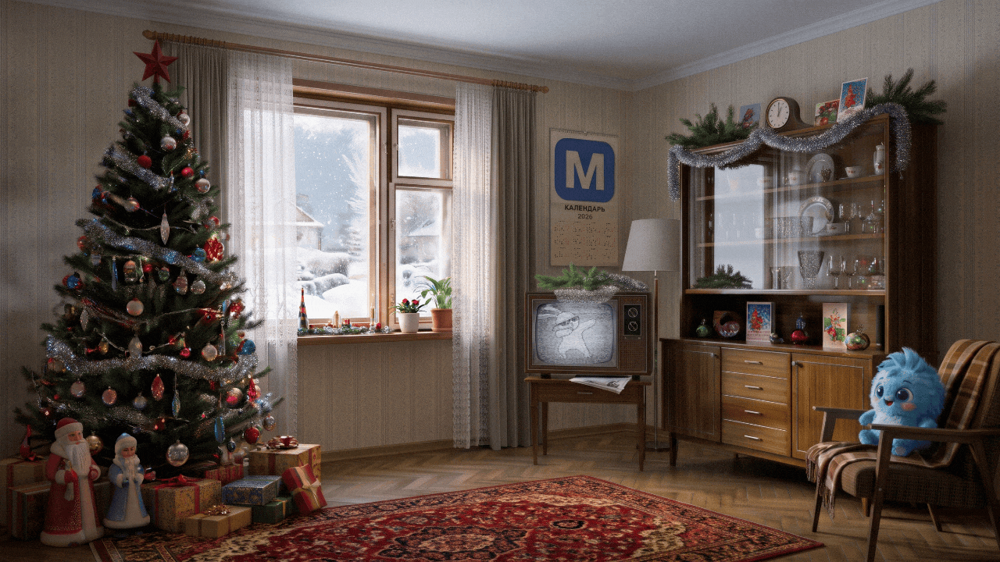
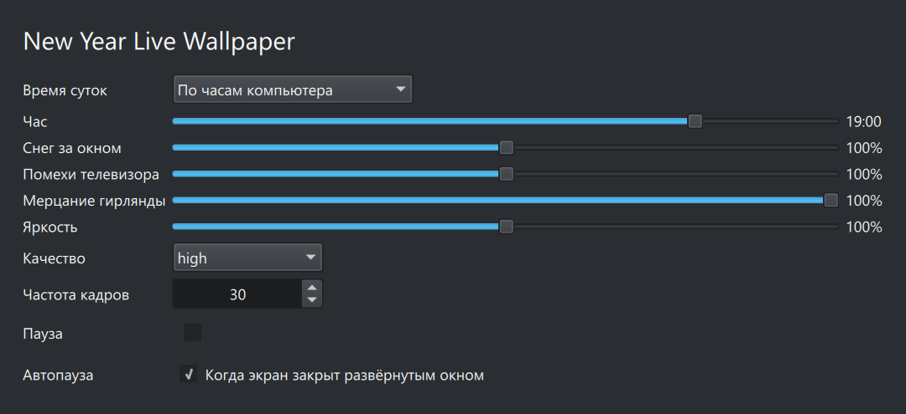

# New Year Live Wallpaper



## Настройки в KDE Plasma



В настройках рабочего стола выбрать тип обоев **New Year Live Wallpaper**.
Доступны время суток (по часам компьютера или вручную), снег за окном, помехи телевизора,
мерцание гирлянды, яркость, качество, частота кадров, пауза и автопауза, когда экран закрыт
развёрнутым окном. Для меньшей нагрузки выбрать eco и 15-25 кадров/с.

## Свет по времени суток

- Солнце рассчитано для 31 декабря и широты Москвы: рассвет около 9:05, закат около 15:55.
- Днём (примерно 9:00-16:00) торшер, гирлянда и свеча выключены, комната в дневном свете.
- Вечером и рано утром, пока жильцы не спят (6:45-23:30), горят люстра, торшер, ёлка, свеча и телевизор.
- Ночью (23:30-6:45) горят только ёлка со звездой, торшер, телевизор и свеча.
- На рассвете и закате дневная картина плавно сменяется вечерней.
- Телевизор: зерно, двоение, срыв строчной синхронизации, бегущая полоса, изредка срыв кадров и потеря сигнала.
- Часы на серванте показывают текущее время.
- Настенный календарь показывает текущий год и настоящую сетку всех месяцев (с учётом високосных лет),
  выходные красным; сегодняшний день обведён красным карандашом.

## Установка

Готовые файлы публикуются в [Releases](https://github.com/xp9k/ny-live-wallpaper/releases):

- `ny-wallpaper-win-<версия>.zip` - тема для Lively Wallpaper. ZIP перетащить в окно Lively. Подробности: [Windows](docs/windows.md).
- `ny-wallpaper-<версия>-1.mos12.noarch.rpm` - пакет для MOS 12 / KDE Plasma 5.27 / Qt 5.15. Установка: `sudo dnf install ./ny-wallpaper-<версия>-1.mos12.noarch.rpm`. Подробности: [MOS 12](docs/mos12.md).
- `ny-wallpaper-<версия>-1.mos13.noarch.rpm` - пакет для MOS 13 / KDE Plasma 6. Установка: `sudo dnf install ./ny-wallpaper-<версия>-1.mos13.noarch.rpm`, затем выбрать **Настройки рабочего стола > Тип обоев > New Year Live Wallpaper**. Подробности: [MOS 13](docs/mos13.md).

Для работы на MOS нужны только штатные Plasma и Qt Quick соответствующей версии. Браузер, Node.js, сервер и внешний проигрыватель не используются. На Windows тема работает через Lively; Node.js для неё не нужен.

## Структура

```text
artwork/            исходные картины: evening.jpg (вечер, весь свет включён) и day.jpg (день)
src/                сцена, текстуры и веб-рендерер (Windows / Lively)
plasma/             интеграция с Qt Quick / Plasma
packaging/          RPM spec и метаданные Lively
docs/               инструкции и изображения
build/              подготовка текстур, сборка и проверка пакетов
```

Шейдер и расчёт времени суток находятся в `src/scene.js`. Тело шейдера общее для WebGL, Qt 6 (qsb) и Qt 5 (GLSL);
те же функции времени суток подключаются в QML.

## Как устроено освещение

Для каждого источника (люстра, торшер, гирлянда, телевизор, свеча, окно) задано поле освещённости по комнате.
Вечерняя картина делится на освещение вечернего кадра и умножается на освещение текущего момента, в линейном
цвете. Для выключенных гирлянды, звезды и свечей подготовлена картина без их света; тени от торшера на потолке
и карнизе при выключенном торшере снимаются картой теней. Днём используется дневная картина.

## Разработка и сборка

Для предпросмотра достаточно открыть `src/index.html` в браузере. Параметры URL: `?hour=13` (время вручную),
`?timelapse=60` (сутки за минуту), `?date=2028-02-29` (дата на календаре), `?snow=1.5`, `?tv=0.5`, `?twinkle=0`, `?light=1.2`, `?quality=eco`, `?fps=30`.

```sh
npm ci
npm run setup:browser   # Chromium для предпросмотра и проверок
npm run assets          # текстуры из artwork/ в src/assets (Python, Pillow, numpy)
npm run preview         # GIF, миниатюра и скриншот (нужны gifski и ffmpeg)
npm run settings        # скриншот настроек (PySide6)
npm run check
npm run build           # шейдер Qt 6, пакеты Plasma 5/6, Windows ZIP, исходные архивы RPM
npm test                # состав ZIP, меню Lively и отрисовка темы
npm run rpm             # только Linux с rpmbuild: RPM и тест установки
```

Для `npm run build` нужны Node.js 22+ и Qt 6 Shader Tools (`qsb`); путь можно задать переменной `QSB`.
На Windows весь цикл выполняет `build/build.ps1`: RPM собирается в контейнере podman внутри WSL
(параметры `-Distro`, `-Image`, `-Target mos12|mos13|all`).

Готовые файлы попадают в `dist/`, промежуточные - в `.cache/`. Обе папки не входят в Git.

Автор: [xp9k](https://github.com/xp9k). Лицензия: [MIT](LICENSE).
