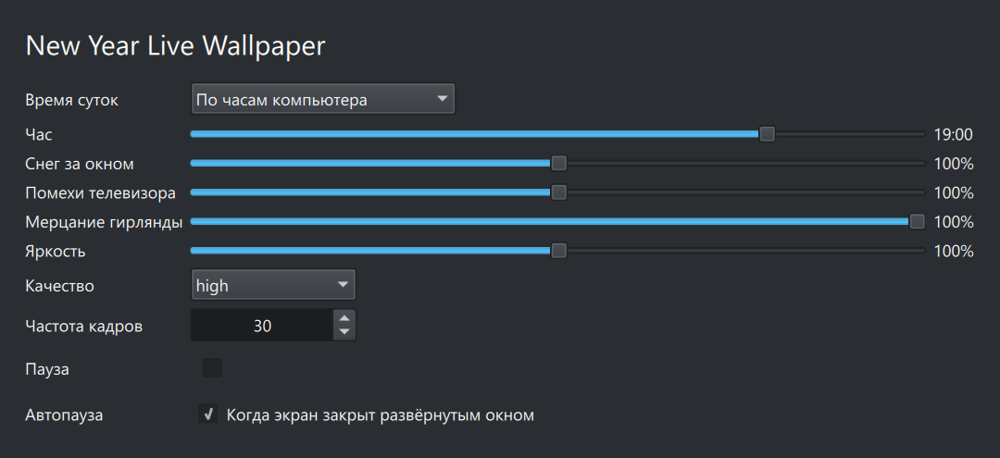

# New Year Live Wallpaper / MOS 13

Установить RPM через системный менеджер пакетов или из папки с файлом:

```sh
sudo dnf install ./ny-wallpaper-1.0.0-1.mos13.noarch.rpm
```

Затем открыть **Настройки рабочего стола > Тип обоев > New Year Live Wallpaper**.
Пакет устанавливается для всех пользователей в
`/usr/share/plasma/wallpapers/org.ny.livewallpaper`.
RPM не меняет текущий фон и не перезапускает Plasma.

Обновление: установить новый RPM той же командой, затем выйти из сеанса и войти заново.
Повторно выбрать обои недостаточно: запущенная Plasma держит в памяти прежнюю версию.
Удаление: `sudo dnf remove ny-wallpaper`.

Если в трее появилось сообщение о программной отрисовке, анимации нет: Plasma не смогла
создать OpenGL-контекст и записала `SceneGraphBackend=software` в `~/.config/kdeglobals`.
Вернуть аппаратную отрисовку: `kwriteconfig6 --file kdeglobals --group QtQuickRendererSettings --key SceneGraphBackend --delete`,
затем войти в сеанс заново.

Требуется Plasma 6 / Qt Quick с аппаратным рендерингом. Анимация работает
внутри Plasma. Браузер, Node.js, сервер и отдельный проигрыватель не нужны.
При программном рендеринге Qt отображается статичное изображение (днём или вечером).

Свет следует часам компьютера: днём комната в дневном свете, торшер, гирлянда
и свеча на окне выключены; вечером горят люстра, торшер, ёлка, свеча и телевизор;
ночью (23:30-6:45) только ёлка, торшер, телевизор и свеча. Солнце рассчитано для
31 декабря и широты Москвы. Можно выбрать режим «Вручную» и задать час.
За окном идёт снег, у телевизора помехи, часы на серванте показывают текущее время,
настенный календарь - текущий год с сегодняшним днём, обведённым красным карандашом.

В настройках доступны время суток, снег, помехи телевизора, мерцание гирлянды,
яркость, качество, частота кадров, пауза и автопауза. Автопауза включена по
умолчанию: пока экран закрыт развёрнутым или полноэкранным окном на текущем
рабочем столе, анимация останавливается и не нагружает процессор. Это особенно
заметно при трансляции экрана (Veyon, VNC, RustDesk).



Для меньшей нагрузки выбрать eco и уменьшить частоту кадров.
